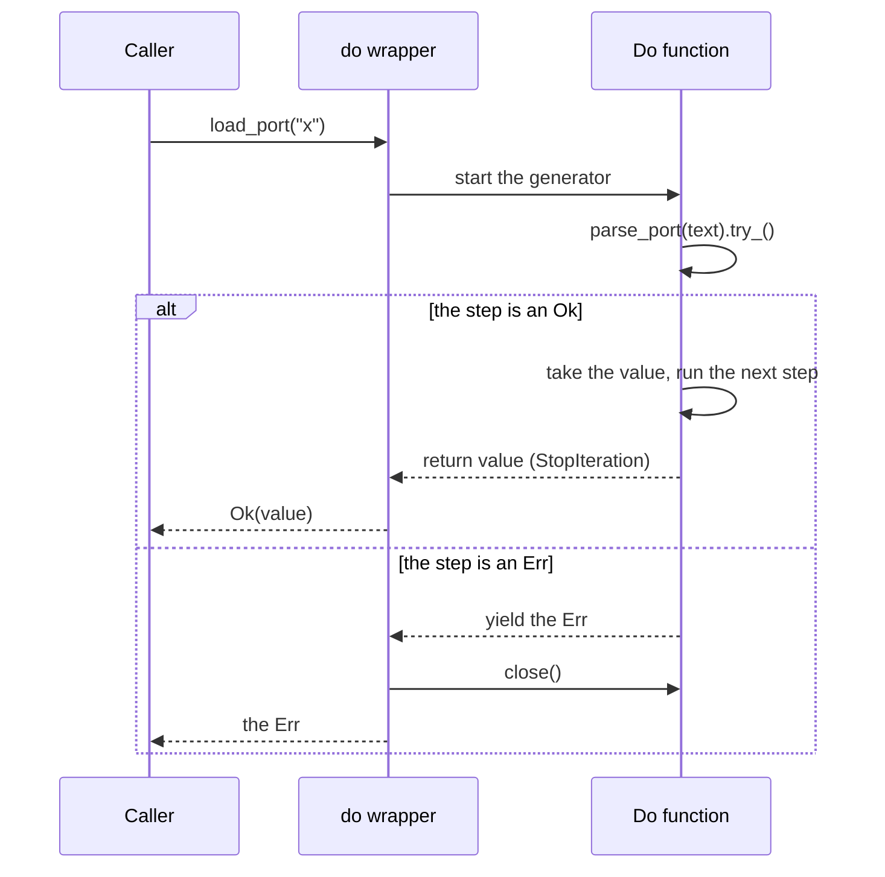

# Option and Result — Design

## Context

`oxide.py` v1 ports Rust's `Option<T>` and `Result<T, E>` to Python as the `oxide` package. A function returns an Option or a Result, so that an absent value or an expected failure is part of its type, and a type checker forces the caller to handle it. The design beats the existing libraries on three points: narrowing that each of four checkers proves in both branches, no checker plugin, and a small, pinned and CI-tested codebase. Library callers use it; v1 ships on PyPI ([release.md](release.md)).

## Constraints

- Ruff checks `src/` and `tests/` at 79 columns: annotations on every signature, PEP 257 docstrings, PEP 8 names, the `_co` suffix on a covariant TypeVar, and absolute imports ([python.md](conventions/python.md)).
- A keyword name takes a trailing underscore, and each public module sets `__all__` ([python.md](conventions/python.md)). A public item has a docstring when it carries a fact that its name and signature do not ([comments.md](conventions/comments.md)).
- The terms are those of [CONTEXT.md](../CONTEXT.md). A Some can hold `None`, and an Err holds any value.
- Each picked checker reports zero errors on the package and the tests, with no plugin and no library-specific config on the caller's side ([CLAUDE.md](../CLAUDE.md)).
- Python 3.10 is past its end of life (2026-10-01). Python 3.11 is the oldest supported version, until 2027-10-31.
- A covariant TypeVar cannot be a method parameter on any of the four checkers. A method that takes a value of the content type uses a second TypeVar.
- ty 0.0.95 infers a lambda passed to a method on a union as `Unknown`, with no error. The tests assert no lambda result on a union.
- ty 0.0.95 types a string literal argument as its `Literal` type, so `assert_type(option.ok_or("x"), Err[str])` fails on ty. The tests assert no type of a literal argument.

## Architecture

One package and one glossary. `_core` imports nothing from the package; `_do` and `_catch` import `_core`.

```
src/oxide/
  __init__.py   re-exports the public names, sets __all__
  _core.py      Ok, Err, Some, Nothing, Result, Option, UnwrapError,
                collect, partition, from_optional
  _do.py        do, Do
  _catch.py     catch
  py.typed
tests/
  test_result.py
  test_option.py
  test_do.py
  test_catch.py
  test_narrowing.py
.github/workflows/ci.yml
.github/dependabot.yml
README.md
```

## Design Gate

| Piece | Kind | Consumer today | Derived from | Change vs base |
|---|---|---|---|---|
| `Ok`, `Err` | public class | callers, the README sample, `tests/` | — | new |
| `Some`, `Nothing` | public class | callers, `tests/` | — | new |
| `Result`, `Option` | type alias | caller annotations | the variant classes | new |
| `Do` | type alias | do function annotations | `Generator`, `Err` | new |
| `UnwrapError` | exception | callers that catch a failed unwrap | — | new |
| `collect`, `partition` | function | callers with a list of Results | — | new |
| `from_optional` | function | callers that hold a `T \| None` | — | new |
| `do` | decorator | do functions, the README sample | — | new |
| `catch` | decorator | functions that raise expected exceptions, the README sample | — | new |
| `py.typed` | marker | the type checkers of callers | — | new |
| `[project]`, `[build-system]`, `[dependency-groups]`, checker settings | `pyproject.toml` | `pip install`, CI, contributors | — | added next to `[tool.ruff]` |
| `ci.yml` | CI workflow | each PR and each push to `main` | — | new |
| `dependabot.yml` | Dependabot config | the maintainer, through weekly PRs | `ci.yml`, `.pre-commit-config.yaml` | new |
| `README.md` | doc | repo readers; `tests/test_narrowing.py` proves its styles | — | new |
| The status line, the commands and the hook pin rule | `CLAUDE.md` | contributors | `[dependency-groups]` | changed |
| The upstream hooks, pinned by SHA | `.pre-commit-config.yaml` | contributors, the `check` job | — | changed |
| The Python entries | `.gitignore` | contributors | — | changed |
| The Ruff rules, the names and the docstrings | `docs/conventions/` | contributors | — | changed |

New public names: 13. New files outside `docs/` and `CONTEXT.md`: 13. Changed files: `pyproject.toml`, `CLAUDE.md`, `.pre-commit-config.yaml`, `.gitignore`, `docs/conventions/python.md` and `docs/conventions/comments.md`. The counts are against the effort branch. Against `main`, which holds only `LICENSE`, every file is new.

Cut review: done 2026-10-31

## API

The variants are `@final` classes with `__slots__`. `Ok`, `Err` and `Some` are generic, and `Nothing` is not. `T_co` and `E_co` are covariant. `U`, `F` and `D` are plain TypeVars.

```python
@final
class Ok(Generic[T_co]):
    __match_args__ = ("value",)

    def __init__(self, value: T_co) -> None: ...
    @property
    def value(self) -> T_co: ...
    def is_ok(self) -> bool: ...
    def is_err(self) -> bool: ...
    def expect(self, message: str) -> T_co: ...
    def expect_err(self, message: str) -> Never: ...
    def unwrap(self) -> T_co: ...
    def unwrap_err(self) -> Never: ...
    def unwrap_or(self, default: object) -> T_co: ...
    def unwrap_or_else(self, function: Callable[[Never], object]) -> T_co: ...
    def map(self, function: Callable[[T_co], U]) -> Ok[U]: ...
    def map_err(self, function: Callable[[Never], object]) -> Ok[T_co]: ...
    def and_then(
        self, function: Callable[[T_co], Result[U, F]]
    ) -> Result[U, F]: ...
    def or_else(self, function: Callable[[Never], object]) -> Ok[T_co]: ...
    def ok(self) -> Some[T_co]: ...
    def err(self) -> Nothing: ...
    def flatten(self: Ok[Result[U, F]]) -> Result[U, F]: ...
    def transpose(self: Ok[Option[U]]) -> Option[Ok[U]]: ...
    def try_(self) -> Generator[Never, Any, T_co]: ...
    def __bool__(self) -> Never: ...


@final
class Err(Generic[E_co]):
    __match_args__ = ("error",)

    def __init__(self, error: E_co) -> None: ...
    @property
    def error(self) -> E_co: ...
    def is_ok(self) -> bool: ...
    def is_err(self) -> bool: ...
    def expect(self, message: str) -> Never: ...
    def expect_err(self, message: str) -> E_co: ...
    def unwrap(self) -> Never: ...
    def unwrap_err(self) -> E_co: ...
    def unwrap_or(self, default: D) -> D: ...
    def unwrap_or_else(self, function: Callable[[E_co], D]) -> D: ...
    def map(self, function: Callable[[Never], object]) -> Err[E_co]: ...
    def map_err(self, function: Callable[[E_co], F]) -> Err[F]: ...
    def and_then(self, function: Callable[[Never], object]) -> Err[E_co]: ...
    def or_else(
        self, function: Callable[[E_co], Result[U, F]]
    ) -> Result[U, F]: ...
    def ok(self) -> Nothing: ...
    def err(self) -> Some[E_co]: ...
    def flatten(self) -> Err[E_co]: ...
    def transpose(self) -> Some[Err[E_co]]: ...
    def try_(self) -> Generator[Err[E_co], Any, Never]: ...
    def __bool__(self) -> Never: ...
```

```python
@final
class Some(Generic[T_co]):
    __match_args__ = ("value",)

    def __init__(self, value: T_co) -> None: ...
    @property
    def value(self) -> T_co: ...
    def is_some(self) -> bool: ...
    def is_nothing(self) -> bool: ...
    def expect(self, message: str) -> T_co: ...
    def unwrap(self) -> T_co: ...
    def unwrap_or(self, default: object) -> T_co: ...
    def unwrap_or_else(self, function: Callable[[], object]) -> T_co: ...
    def map(self, function: Callable[[T_co], U]) -> Some[U]: ...
    def and_then(self, function: Callable[[T_co], Option[U]]) -> Option[U]: ...
    def or_else(self, function: Callable[[], object]) -> Some[T_co]: ...
    def ok_or(self, error: object) -> Ok[T_co]: ...
    def ok_or_else(self, function: Callable[[], object]) -> Ok[T_co]: ...
    def flatten(self: Some[Option[U]]) -> Option[U]: ...
    def transpose(self: Some[Result[U, F]]) -> Result[Some[U], F]: ...
    def to_optional(self) -> T_co: ...
    def __bool__(self) -> Never: ...


@final
class Nothing:
    def __new__(cls) -> Nothing: ...
    def __reduce__(self) -> tuple[type[Nothing], tuple[()]]: ...
    def is_some(self) -> bool: ...
    def is_nothing(self) -> bool: ...
    def expect(self, message: str) -> Never: ...
    def unwrap(self) -> Never: ...
    def unwrap_or(self, default: D) -> D: ...
    def unwrap_or_else(self, function: Callable[[], D]) -> D: ...
    def map(self, function: Callable[[Never], object]) -> Nothing: ...
    def and_then(self, function: Callable[[Never], object]) -> Nothing: ...
    def or_else(self, function: Callable[[], Option[U]]) -> Option[U]: ...
    def ok_or(self, error: F) -> Err[F]: ...
    def ok_or_else(self, function: Callable[[], F]) -> Err[F]: ...
    def flatten(self) -> Nothing: ...
    def transpose(self) -> Ok[Nothing]: ...
    def to_optional(self) -> None: ...
    def __bool__(self) -> Never: ...
```

```python
Result: TypeAlias = Ok[T] | Err[E]
Option: TypeAlias = Some[T] | Nothing
Do = TypeAliasType("Do", Generator[Err[E], Any, T], type_params=(T, E))


class UnwrapError(Exception): ...


def collect(items: Iterable[Result[T, E]]) -> Result[list[T], E]: ...
def partition(items: Iterable[Result[T, E]]) -> tuple[list[T], list[E]]: ...
def from_optional(value: T | None) -> Option[T]: ...
def do(
    function: Callable[P, Generator[Err[E], Any, T]],
) -> Callable[P, Result[T, E]]: ...
@overload
def catch(
    exception_1: type[X1], /
) -> Callable[[Callable[P, R]], Callable[P, Result[R, X1]]]: ...
@overload
def catch(
    exception_1: type[X1], exception_2: type[X2], /
) -> Callable[[Callable[P, R]], Callable[P, Result[R, X1 | X2]]]: ...
@overload
def catch(
    exception_1: type[X1], exception_2: type[X2], exception_3: type[X3], /
) -> Callable[[Callable[P, R]], Callable[P, Result[R, X1 | X2 | X3]]]: ...
```

`X1`, `X2` and `X3` are bound to `Exception`. On a union such as `Result[int, str]`, each method call resolves on both variants: `result.unwrap()` is `int`, and `result.and_then(function)` accumulates the error types, `Err[str] | Err[ValueError]`.

```python
from oxide import Do, Err, Ok, Result, catch, do


@catch(ValueError)
def parse_port(text: str) -> int:
    return int(text)


def check_range(port: int) -> Result[int, str]:
    return Ok(port) if 0 < port < 65_536 else Err(f"out of range: {port}")


@do
def load_port(text: str) -> Do[int, ValueError | str]:
    port = yield from parse_port(text).try_()
    return (yield from check_range(port).try_())


match load_port("8080"):
    case Ok(port):
        print(port)
    case Err(error):
        print(error)
```

## Narrowing styles

`README.md` lists these two styles, and `tests/test_narrowing.py` proves each one in both branches, on Result and Option, at runtime and on each of the four checkers.

| Style | Result | Option |
|---|---|---|
| `match`, the primary style | `case Ok(value):`, `case Err(error):`, then `assert_never` | `case Some(value):`, `case Nothing():`, then `assert_never` |
| `isinstance` | `isinstance(result, Ok)` | `isinstance(option, Some)` |

`is_ok()`, `is_err()`, `is_some()` and `is_nothing()` return `bool` and narrow nothing. A method cannot narrow its own `self` (PEP 742), and the README says so. A variant has no truth value: `bool()` raises `TypeError` ([adr/0003](adr/0003-variants-have-no-truth-value.md)).

## Do functions

A do function replaces Rust's `?` ([adr/0001](adr/0001-do-function-with-try-replaces-question-mark.md)). Do functions take Results only: an Option converts first with `ok_or`. `do` raises `TypeError` when it decorates a function that is not a generator function, and when the do function yields a value other than an Err.



## Errors

`unwrap`, `expect`, `unwrap_err` and `expect_err` raise `UnwrapError` on the other variant. When the error is an exception, they raise `from` it, so the traceback keeps the original exception.

| Call | On | Message |
|---|---|---|
| `unwrap()` | `Err` | ``called `Result.unwrap()` on an `Err` value: {error!r}`` |
| `expect(message)` | `Err` | `{message}: {error!r}` |
| `unwrap_err()` | `Ok` | ``called `Result.unwrap_err()` on an `Ok` value: {value!r}`` |
| `expect_err(message)` | `Ok` | `{message}: {value!r}` |
| `unwrap()` | `Nothing` | ``called `Option.unwrap()` on a `Nothing` value`` |
| `expect(message)` | `Nothing` | `{message}` |

`catch` raises `TypeError` at decoration time when it gets no exception type, `Exception`, or a value that is not a subclass of `Exception`, such as an instance or `KeyboardInterrupt`. Inside the decorated function, an exception of a listed type becomes an Err, even when a bug raised it. Each other exception propagates unchanged, and so does each exception that a callback raises outside `catch`.

`Err.try_()` raises `RuntimeError` when a caller resumes it after its Err, which happens only outside `@do`.

## Runtime behavior

| Behavior | Rule |
|---|---|
| Immutability | `__slots__` and read-only properties: an assignment to `value`, `error` or a new attribute raises `AttributeError`. |
| Equality | The same variant class and equal content: `Ok(1) == Ok(1)`, `Ok(1) != Some(1)`. |
| Hash | The hash of the variant class and its content. Unhashable content makes the variant unhashable. |
| `repr` | `Ok(1)`, `Err('empty')`, `Some(None)`, `Nothing()`. |
| Pickle and copy | Pickle protocol 2 or later and `copy.deepcopy` work on the slots of `Ok`, `Err` and `Some`. Protocols 0 and 1 raise `TypeError` for a class with `__slots__`. `Nothing.__reduce__` rebuilds through `Nothing()`, so every protocol keeps one instance. |
| Truth value | None: `bool()` raises `TypeError` ([adr/0003](adr/0003-variants-have-no-truth-value.md)). |
| Iteration | None: the variants have no `__iter__`. |

## Packaging and CI

```toml
[project]
name = "oxide.py"
requires-python = ">=3.11"
license = "MIT"
readme = "README.md"
dependencies = ['typing_extensions>=4.6; python_version < "3.12"']

[build-system]
requires = ["hatchling"]
build-backend = "hatchling.build"

[tool.hatch.build.targets.wheel]
packages = ["src/oxide"]

[dependency-groups]
dev = [
    "ruff==0.17.3",
    "pre-commit==4.7.0",
    "pytest==9.2.0",
    "mypy==2.4.1",
    "pyright==1.1.414",
    "ty==0.0.95",
    "pyrefly==1.4.0",
]
```

`packages` is needed because the distribution name `oxide.py` differs from the import name `oxide`. [release.md](release.md) gives the version, the PyPI metadata and the sdist content. `typing_extensions` supplies `TypeAliasType` below 3.12 only.

| Checker | Mode | Target | Paths |
|---|---|---|---|
| mypy | `strict` | 3.11 | `src`, `tests` |
| pyright | `strict` | 3.11 | `src`, `tests` |
| ty | default | 3.11 | `src`, `tests` |
| pyrefly | default | 3.11 | `src`, `tests` |

The checker settings live in `pyproject.toml`. pyright also needs `venvPath = "."` and `venv = ".venv"`, because it does not use the Python that runs it. At the pinned versions, each checker reports a missing `match` case and an Err type that `Do[T, E]` leaves out. A check by hand proves it, because the repo holds no committed negative case. `--group` needs pip 25.1 or later, and Python 3.11 and 3.12 bundle pip 24.2, so each install upgrades pip first. `ci.yml` runs on each PR and each push to `main`:

| Job | Python | Steps |
|---|---|---|
| `test` | 3.11, 3.12, 3.13, 3.14, 3.15 | Install `.` alone in a separate venv, import `oxide` and find `py.typed`. Create `.venv`, run `pip install -U pip`, install `-e . --group dev`, run pytest. |
| `check` | 3.14 | Install the same way, run `pre-commit run --all-files`, then the four checkers. |

## Key Decisions

| Decision | Choice | Rationale |
|---|---|---|
| Names | Distribution `oxide.py`, import `oxide` | It matches the repo, and `oxide-py` is free on PyPI. **`oxide_py` import.** Rejected: it reads worse in `from … import`. |
| Structure | Union aliases of `@final` classes | Only a closed union makes `match` with `assert_never` exhaustive on all four checkers. **A base class.** Rejected: it leaves the union open. |
| Attributes | Read-only `value` and `error` properties over slots | A property keeps the class covariant; under PEP 695 a plain attribute is invariant on all four checkers. |
| Nothing | `Nothing()`, one instance | [adr/0002](adr/0002-nothing-is-a-final-class-singleton.md). |
| Query methods | `is_ok()`, `is_err()`, `is_some()`, `is_nothing()`, returning `bool` | They keep Rust's names for calls such as `filter(lambda result: result.is_ok(), results)`, and the README says that they narrow nothing. **Rust's `is_none()`.** Rejected: it reads as a check for Python's `None`. |
| Methods | The unwrap, transform, collect and convert set in API | Rust's core API sets the v1 scope: `map`, `and_then`, the `unwrap` family, `ok`, `err`, `collect`, `partition`, `transpose`, `flatten`, `from_optional`, `to_optional`. `expect`, `expect_err`, `map_err`, `or_else`, `ok_or` and `ok_or_else` complete Rust's pairs. **All portable Rust methods.** Rejected: twice the size, with no v1 caller for the rest. |
| `collect` | Results only | On an empty input, the runtime cannot choose between `Ok([])` and `Some([])`. **One overloaded `collect` for both types.** Rejected: an empty list of Options returns the wrong variant. |
| Narrowing styles | `match`, `isinstance` | Each narrows both branches on all four checkers. **`TypeIs` free functions.** Rejected: they repeat `isinstance`. **Truthiness.** Rejected: a true `Some(0)` or `Ok([])` hides a bug ([adr/0003](adr/0003-variants-have-no-truth-value.md)). |
| `?` substitute | Do functions with `try_()`, Results only | [adr/0001](adr/0001-do-function-with-try-replaces-question-mark.md). An Option converts with `ok_or`, which keeps one `Do` alias. |
| Bugs | No `Panic`; `UnwrapError` for a failed unwrap | Python already propagates each callback exception. **better-result's `Panic`.** Rejected: it wraps every callback to cover one case inside `catch`. |
| `catch` | 1 to 3 exception types, bound to `Exception`; `TypeError` for `Exception` and for each value that is not a subclass of it | It converts expected exceptions only. **One `*exceptions` signature.** Rejected: mypy widens the union to a common base class. |
| Runtime checks | `do` and `catch` raise `TypeError` for input that their annotations reject | A caller with no checker gets an error at the bad call, not a wrong value later: a bare `yield` would return the yielded value as the result, and `catch(KeyboardInterrupt)` would turn Ctrl-C into an Err. **Static checks only.** Rejected: `catch(BaseException)` already needs a runtime check. |
| `UnwrapError` | No extra attributes; Rust messages with `repr`; `raise from` | No v1 caller reads the variant from the exception, and `raise from` keeps the original traceback. |
| Docstrings | A public item that carries a fact its name and signature do not: what the call does in each case, what it raises, or a trap | An editor's hover and `help()` are the in-editor docs of a library, and an obvious docstring adds only noise. Ruff checks the form, not the presence: its `D1` rules skip `_` modules. **A docstring on every public item.** Rejected: `value` and `is_ok()` would restate their names. |
| Runtime | `__slots__`, read-only properties, `==`, `hash`, `repr`, pickle protocol 2 or later, `Nothing.__reduce__` | Pickle has users in multiprocessing and caches. Pickle protocols 0 and 1 skip `__new__`, so `Nothing` needs `__reduce__` to stay one instance. Without `__hash__`, `__eq__` makes every variant unhashable. **Ordering and `copy.replace`.** Rejected: no v1 caller. **A raising `__setattr__` with `__reduce__` on each variant.** Rejected: slots and read-only properties already block public writes, and the default protocol, which multiprocessing uses, works for `Ok`, `Err` and `Some`. |
| Async | None in v1 | It would double the API surface. |
| Cuts | No pydantic extra, benchmark, `sum` or `product` | None has a user before a release. |
| Minimum Python | 3.11, old TypeVar syntax | It reaches the most users. Ruff's `UP046` and `UP047` move the code to PEP 695 when 3.11 reaches end of life. **3.12 or 3.13.** Rejected: they drop 3.11 a year early. |
| Dependencies | `typing_extensions` below 3.12 only | `TypeAliasType` is the only feature that 3.11 lacks. |
| Checkers | mypy, pyright, ty, pyrefly, each with an exact pin | Proof on all four is the narrowing point. Exact pins keep a new release of ty, which is pre-1.0, out of CI. |
| Tests | Plain pytest; `tests/test_narrowing.py` holds the `assert_type` proofs | Narrowing is a static check, and one file proves each style at runtime and statically. **Gherkin.** Rejected: its steps check runtime behavior only. |
| CI | pytest on 3.11 to 3.15; one `check` job targeting 3.11 | All four checkers give the same result at 3.11 and 3.14. CI is the only test path below the `.venv` version. A venv with only the package proves the `typing_extensions` marker and `py.typed`, which the dev tools hide. |
| Updates | Dependabot, weekly with a 7-day cooldown, for the actions and the hooks except Ruff | The Ruff hook moves only together with the Ruff dev pin, so that local Ruff and the hook agree. The dev pins stay manual. |
| Packaging | `hatchling`, `src/oxide/`, `py.typed` | The README install step and CI need a build backend. [release.md](release.md) gives the version. |
| Dev tools | `[dependency-groups] dev` with exact pins | One list serves CI, contributors and `.venv`. |
| Modules | `_core`, `_do` and `_catch`, re-exported from `__init__` | Option and Result call each other, so they share `_core`, and no import is circular. |
| README | Install steps, one usage sample, the two styles, a migration table from `rustedpy/result` 0.17.0 | The narrowing tests prove the styles that it lists. `rustedpy/result` is archived, so its users need a table that maps its API to `oxide`. |

## Unresolved Questions

None outstanding.
