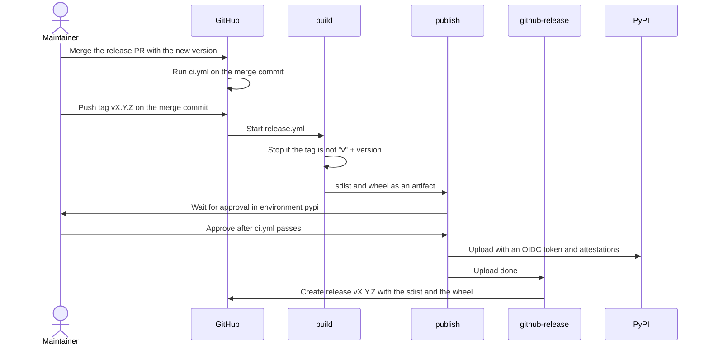

# Release — Design

## Context

A caller installs `oxide.py` from PyPI and pins a version, such as `pip install oxide.py==1.0.0`. A push of a `v*` tag runs `.github/workflows/release.yml`. It builds the sdist and the wheel, uploads them to PyPI after the maintainer approves, and creates the GitHub release. The first release is `1.0.0`.

## Constraints

- PyPI accepts each version once. A deleted or yanked version cannot be uploaded again.
- PyPI normalizes the distribution name `oxide.py` to `oxide-py`. `version` is a static value in `pyproject.toml`.
- The default hatchling sdist holds each file that `.gitignore` does not exclude, untracked files included. Hatchling always adds `pyproject.toml`, the readme, the license files and `.gitignore`.
- `ci.yml` pins each action by commit SHA with a version comment, and checks out with `persist-credentials: false`. Dependabot updates the pins weekly ([option-and-result.md](option-and-result.md), Key Decisions: Updates).
- [CLAUDE.md](../CLAUDE.md) requires the user's approval before each PyPI upload and each GitHub release.
- [CLAUDE.md](../CLAUDE.md) forbids public API outside the design, so the package has no `__version__`. A caller reads the version with `importlib.metadata.version("oxide.py")`.
- Under semver, `1.0.0` fixes the API in [option-and-result.md](option-and-result.md). A breaking change needs `2.0.0`, and a new method needs a minor version.
- PyPI renders the README with `readme_renderer`, which resolves its anchor links but keeps a relative link as it is.

## Architecture

The release is cross-cutting. It changes no module of `src/oxide/`.

```
.github/workflows/release.yml   build, publish, github-release
pyproject.toml                  version, metadata, sdist include list
README.md                       install step, link to the narrowing tests
LICENSE                         copyright holder
docs/option-and-result.md       release status, no version number
docs/spec.md                    user story 14, no version number
```

### `release.yml`

`on: push: tags: ["v*"]`. Each action is pinned by SHA, as in `ci.yml`.

| Job | Needs | Environment | Permissions | Steps |
|---|---|---|---|---|
| `build` | — | — | `contents: read` | Check out with `persist-credentials: false`. Set up Python 3.14. Stop when `GITHUB_REF_NAME` is not `v` + `version`. Install `build==1.6.1` and run `python -m build`. Upload `dist/` as an artifact. |
| `publish` | `build` | `pypi` | `id-token: write` | Download `dist/`. Run `pypa/gh-action-pypi-publish`, which uploads with an OIDC token and adds PEP 740 attestations. |
| `github-release` | `publish` | — | `contents: write` | Download `dist/`. Run `gh release create "$GITHUB_REF_NAME" dist/* --generate-notes`. |

### `pyproject.toml`

```toml
[project]
name = "oxide.py"
description = "Rust's Option<T> and Result<T, E>, implemented for Python."
authors = [{ name = "Andrew Kartava" }]
classifiers = [
    "Development Status :: 5 - Production/Stable",
    "Programming Language :: Python :: 3 :: Only",
    "Programming Language :: Python :: 3.11",
    "Programming Language :: Python :: 3.12",
    "Programming Language :: Python :: 3.13",
    "Programming Language :: Python :: 3.14",
    "Programming Language :: Python :: 3.15",
    "Typing :: Typed",
]

[project.urls]
Repository = "https://github.com/kartava/oxide.py"
Issues = "https://github.com/kartava/oxide.py/issues"
Changelog = "https://github.com/kartava/oxide.py/releases"

[tool.hatch.build.targets.sdist]
include = ["/src", "/tests"]
```

`version` is in `pyproject.toml` only (Key Decisions: Version in docs). The other `[project]` fields stay as [option-and-result.md](option-and-result.md) gives them.

## Flow



## Release Steps

The release PR sets `version` in `pyproject.toml`. After it merges:

```sh
git switch main && git pull --ff-only
git tag vX.Y.Z
git push origin vX.Y.Z
```

Then approve the `publish` job in the Actions UI, after `ci.yml` on the tagged commit passes.

## Failure

| Failure | State | Recovery |
|---|---|---|
| The tag check fails, or the maintainer rejects the approval | PyPI holds no file of the version. The tag stays on `origin`. | Delete the tag, merge the fix, and run the Release Steps again. |
| `publish` fails | PyPI holds no file of the version, or holds some of its files. | With no file on PyPI, re-run the failed jobs, or delete the tag and retag when the fix needs a new commit. With a file on PyPI, release the next patch version. |
| `github-release` fails | PyPI holds the version. | Re-run the failed jobs. A full re-run fails at `publish`, because PyPI rejects the files a second time. |

```sh
git push --delete origin vX.Y.Z
git tag -d vX.Y.Z
```

## Setup

Each setting exists before the first tag push.

| Setting | Who | Where | Values |
|---|---|---|---|
| A PyPI account with 2FA | Maintainer | pypi.org | — |
| A pending trusted publisher | Maintainer | pypi.org, Publishing | Project `oxide.py`, owner `kartava`, repo `oxide.py`, workflow `release.yml`, environment `pypi` |
| Environment `pypi` with a required reviewer and a tag rule | A ticket, through `gh api`, after the maintainer approves | GitHub repo settings | Reviewer `kartava` (user ID 13851534); deployment tags `v*` only |

## Design Gate

| Piece | Kind | Consumer today | Derived from | Change vs base |
|---|---|---|---|---|
| `release.yml` | CI workflow | The maintainer, through a tag push | — | new |
| The tag check in `build` | workflow step | The maintainer, at each tag push | `version` in `pyproject.toml` | new |
| Environment `pypi` | GitHub setting | The `publish` job; the PyPI trusted publisher | — | new |
| The pending publisher | PyPI setting | The `publish` job | — | new |
| `version = "1.0.0"` | `pyproject.toml` | PyPI, pip, callers who pin | — | changed |
| `description`, `authors`, `classifiers`, `[project.urls]` | `pyproject.toml` | The PyPI project page and its filters | The GitHub repo description | new |
| The sdist include list | `pyproject.toml` | The `build` job, which builds the wheel from the sdist | — | new |
| GitHub release `vX.Y.Z` with the sdist and the wheel | GitHub release | The `Changelog` URL; readers of the repo | The PRs since the last tag | new |
| The install step | `README.md` | Readers of the repo and of the PyPI page | — | changed |
| The link to `tests/test_narrowing.py`, as an absolute URL | `README.md` | Readers of the PyPI page | — | changed |
| The copyright holder | `LICENSE` | Readers of the license file in the sdist and the wheel | `authors` | changed |
| The release status, with no version number | `docs/option-and-result.md` | Contributors | `pyproject.toml`, this doc | changed |
| User story 14, Out of Scope, the Packaging row with no version number | `docs/spec.md` | Contributors | `pyproject.toml`, this doc | changed |

New public names: 0. New files: `release.yml`. New permissions: `id-token: write` on `publish`, `contents: write` on `github-release`. New settings: environment `pypi` and the pending publisher. Changed files: `pyproject.toml`, `README.md`, `LICENSE`, `docs/option-and-result.md` and `docs/spec.md`.

Cut review: done 2026-10-31

## Key Decisions

| Decision | Choice | Rationale |
|---|---|---|
| First version | `1.0.0` | The v1 API in [option-and-result.md](option-and-result.md) is complete, and a caller who pins `1.x` gets no breaking change. |
| Upload | GitHub Actions with PyPI trusted publishing | The repo stores no secret, and a clean checkout keeps untracked files, such as `.coverage`, out of the sdist. **An API token in a repo secret.** Rejected: a long-lived secret to store and rotate. **A local `twine upload`.** Rejected: a local build adds untracked files to the sdist. |
| Trigger | A push of a `v*` tag | The tag records the released commit, and the GitHub release follows a successful upload. **A published GitHub release.** Rejected: a failed upload leaves a release with no package. **A manual run.** Rejected: it records no commit. |
| Approval | Environment `pypi` with the maintainer as required reviewer, and a deployment rule for tags `v*` only | A version uploads once, so an approval stops an accidental tag push, such as `git push --tags`. The publisher names the environment, so only `publish` can upload, and the tag rule refuses the environment to a run on any other ref, such as a PR from a fork. **No environment.** Rejected: each job of the workflow could upload. **The reviewer without the tag rule.** Rejected: an approval by mistake is then the only check of the ref. |
| Dry run | None | A wrong publisher config or a README that PyPI cannot render stops the upload and leaves the version free. `ci.yml` already builds the package and imports it. **TestPyPI once.** Rejected: a second account and publisher for errors that cost nothing. **TestPyPI on each push.** Rejected: it needs a dynamic version. |
| Version source | A static `version` in `pyproject.toml` | The release PR diff shows the version, and the build needs no plugin. **`hatch-vcs`.** Rejected: a checkout without tags builds a fallback version. |
| Tag check | `build` stops when the tag is not `v` + `version` | A tag on a commit with an older `version`, such as `0.1.0`, would release that version by mistake, and PyPI never accepts it again. |
| Tests in `release.yml` | None | The push of the merge commit already ran `ci.yml`, and the maintainer checks it before the approval. `python -m build` builds the wheel from the sdist, so the build proves the include list. **pytest on the built wheel.** Rejected: it repeats `ci.yml` on the same commit. |
| Build tool | `build==1.6.1` in the workflow; `hatchling` unpinned | The repo pins each tool exactly ([option-and-result.md](option-and-result.md), Key Decisions: Dev tools). **A `hatchling` pin in `[build-system]`.** Rejected: it binds each packager who builds from the sdist. |
| GitHub release | `github-release` after `publish`, with `--generate-notes`, the sdist and the wheel | The release cannot exist without its PyPI package, and the generated notes are the changelog. A reader of the release gets the files without PyPI. **Created by hand.** Rejected: the release can be missing, or exist before the upload. |
| sdist content | `include = ["/src", "/tests"]` | The sdist holds the files that a build and a test run read, and a packager can run the tests. `CLAUDE.md`, `docs/` and `.github/` stay in the repo. **The default content.** Rejected: it ships repo files that no reader of the sdist uses. |
| Metadata | `description`, `authors` with no email, the classifiers and the three URLs in Architecture | The PyPI page and its filters read them, and `Typing :: Typed` marks the main feature. Issues give a contact path. The Python version classifiers repeat the `ci.yml` matrix, so the PR that adds a Python version to the matrix adds its classifier. **Only `3 :: Only` and `Typing :: Typed`.** Rejected: the PyPI filters and sidebar read the version classifiers, not `requires-python`. **A license classifier.** Rejected: hatchling rejects it next to the PEP 639 `license` expression. **`keywords`.** Rejected: the description holds the search words. |
| `LICENSE` holder | Andrew Kartava | It matches `authors`. |
| Version in docs | Only `pyproject.toml` names it. [option-and-result.md](option-and-result.md) and [spec.md](spec.md) cite this doc. | A release PR then edits one line, and no doc drifts. **The number in each doc.** Rejected: each release would edit three more lines. |
| README test link | An absolute GitHub URL to `tests/test_narrowing.py` | PyPI keeps a relative link as it is, and the target does not exist on PyPI. |
| Release steps | This doc only | [CLAUDE.md](../CLAUDE.md) keeps its approval rule, and the tag push is the action that the rule covers. |
| Setup of environment `pypi` | `gh api`, in a ticket, after the maintainer approves | The call records the exact settings. Only the maintainer's account can add the pending publisher on pypi.org. |
| PR split | One PR, then the tag | The tag needs `release.yml` on `main`. The README install step fails only between the merge and the approval. **Two PRs.** Rejected: a second review to close a gap of minutes. |

## Unresolved Questions

None outstanding.
